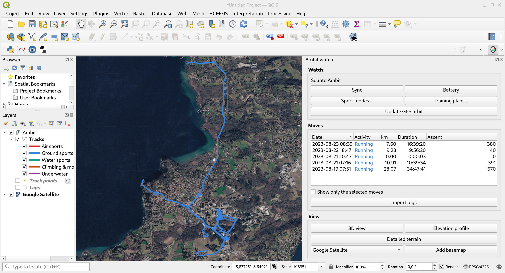

# QAmbit

QAmbit puts Suunto Ambit watches in QGIS. It does what
[openambit2](https://github.com/YannChemin/openambit2) does, and uses QGIS's own
tools wherever QGIS has one: layers, styling, 3D views, the elevation profile,
the time slider, Processing and the task manager.



| openambit2 | QAmbit |
|---|---|
| Device detection (udev) | Watches `/dev` for Suunto HID devices (vendor 0x1493) |
| Sync: moves, time, GPS orbit | `openambit-cli` run as a QGIS task, with progress and cancel |
| Log list and log view | Panel listing the moves; tracks, fixes and laps as GeoPackage layers |
| Leaflet 2D map | QGIS map canvas, basemaps from the HCMGIS plugin |
| CesiumJS 3D map | QGIS 3D view, opened automatically for air sports |
| Terrain (Terrain Tiles / Copernicus) | Terrain Tiles layer, Copernicus DEM, **IGN LiDAR HD** (50 cm, France) |
| Altitude chart | QGIS elevation profile along the selected move |
| Replay | QGIS temporal controller on the fixes |
| Sport mode editor, air sports templates | Sport mode dialog, same `sport_modes.json` |
| Training plans | Training plan dialog, same `training_plans.json` |
| Settings dialog | QGIS *Options ▸ QAmbit* page |

Movescount upload and the Movescount App Zone compiler are not carried over:
the service is gone.

## Requirements

- QGIS 3.34 or later (Qt5 or Qt6), with 3D support for the 3D views.
- `openambit-cli` from openambit2 with the offline options (`--info-json`,
  `--orbit-file`, `--sport-modes`, `--training-plan`). QAmbit looks for it in
  `~/dev/openambit2/build/src/openambit-cli/`, on the `PATH`, then in
  `/usr/bin` and `/usr/local/bin`; another path can be set in the options.
- Read/write access to the watch's `hidraw` node (the udev rule shipped with
  openambit2).
- The [HCMGIS](https://plugins.qgis.org/plugins/HCMGIS/) plugin for basemaps
  (declared in `plugin_dependencies`). Everything else works without it.
- For GPS orbit updates: openambit2's `tools/rinex2ubx_ambit.py`.

## Install

From a clone:

```sh
make deploy          # links this folder into the default QGIS profile
```

then enable *QAmbit* in *Plugins ▸ Manage and Install Plugins*. `make zip`
builds a package for *Install from ZIP*.

## Use

- **Sync**: plug in the watch and press *Sync*. QAmbit updates the GPS orbit
  file, reads the new moves into `~/.openambit`, sets the watch time, writes
  the orbit, then imports the moves into the store (`~/.openambit/qambit.gpkg`).
  New air sports moves open in a 3D view.
- **Moves**: selecting moves in the panel zooms to them; *Show only the
  selected moves* filters the layers. Tracks are LineStringZM (Z altitude,
  M seconds from the start), styled by category (air, ground, water,
  vertical, underwater). The *Track points* layer is time-enabled: the
  temporal controller replays a move.
- **3D view**: drapes the HCMGIS 3D basemap over the terrain and shows the
  tracks at their recorded altitude. A geographic or Web Mercator project is
  switched to the local UTM zone, so distances and heights are true; the
  project's full extent is set to the moves, the extent QGIS builds the scene
  over.
- **Detailed terrain**: downloads the elevation around the selected moves
  and makes it the project terrain (3D views and elevation profile):
  - **IGN LiDAR HD** in metropolitan France: the surface model (MNS, with
    trees and buildings, the default) or the terrain model (MNT). The
    Geoplateforme WFS gives the coverage and the WMS-R serves any
    Lambert-93 box at any size, so QAmbit fetches the box itself at the
    finest resolution that keeps it under 64 Mpx (0.5 m for about 4 x 4 km,
    5 m for 25 x 25 km), in 2000-px chunks. Same services as the
    `r.in.lidarhd` GRASS addon.
  - the **Copernicus DEM** elsewhere (GLO-30 up to about a degree, GLO-90
    above).
  Results are cached in `~/.cache/qambit/dem`.
- **Elevation profile**: opens a QGIS elevation profile along the first
  selected move.
- **Sport modes** and **Training plans**: edit the openambit2 files and write
  them to the watch. Air sports templates use the Altitude mode, so that
  climbs are not taken for weather changes.
- **Processing**: *QAmbit ▸ Suunto Ambit* has *Import openambit logs* and
  *Download terrain (IGN LiDAR HD / Copernicus DEM)*, for models and batch
  runs.

Long jobs (sync, import, terrain, orbit) also report to
[MetaMonitor](https://github.com/YannChemin/MetaMonitor) when its spool is
present.

## Translations

French is included. `make ts` refreshes `i18n/*.ts` from the code and
`make qm` compiles them; QAmbit follows the QGIS user interface language.

## Tests

```sh
make test                         # pytest, headless QGIS
QAMBIT_NETWORK=1 make test        # also downloads a small LiDAR HD tile
```

The fixture `tests/data/log_TEST000000000001_2026_07_01_10_00_00.log` is a
synthetic flight, not a real recording.

## Licence

Public domain, see [LICENSE](LICENSE) (Unlicense).
